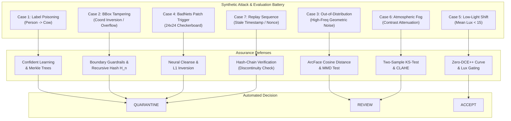

# Dataset Provenance, Open-Data Compliance & Reference Attack Benchmarks (SIH26228)

**Project**: TRINETRA / IBVAP (TCVIAF — Trusted Computer Vision Integrity & Assurance Framework)  
**Problem Statement Reference**: SIH26228 (Defence CV Integrity Assurance)  
**Specification Standard**: Zero-Trust Cryptographic Assurance & Reproducible Open Evaluation  
**Last Audited**: 2026-10-01  

---

## 1. Executive Compliance Declaration

> **Mandatory Clause (SIH26228)**:  
> *"All development and evaluation data will be publicly available under applicable licences or synthetically generated. No classified, operational or service-generated data will be used."*

TRINETRA (TCVIAF) strictly adheres to this mandate across all training, validation, behavioral probing, and testing workflows:

1. **Zero Classified or Operational Data**: No live CCTV feeds, operational surveillance recordings, or military data assets have been acquired, ingested, or stored.
2. **Open-Access Licensing**: All third-party development and evaluation datasets are restricted to verified public licenses (e.g., CC-BY-4.0, MIT, Apache-2.0, NIST Public Domain).
3. **Synthetic Attack Generation**: Adversarial attack patterns, low-light illumination shifts, atmospheric fog degradations, and inference-time tampering scenarios are 100% synthetically generated offline via deterministic algorithms with SHA-256 cryptographic commitments.
4. **Honest Execution Tracking**: External public benchmarks (such as full NIST TrojAI round weights or BackdoorBench archives) that are not bundled into the offline air-gapped test container are explicitly designated as `REGISTERED_BUT_NOT_EXECUTED`. No hashes or benchmark scores are fabricated.

---

## 2. Open-Data Dataset Registry

The authoritative dataset registry is maintained in [`configs/dataset_manifest.json`](file:///C:/Users/anmol/.gemini/antigravity/scratch/IBVAP_SIH26228/configs/dataset_manifest.json).

| Dataset Identifier | Name & Scope | License | Intended Use | Storage Type | Status |
| :--- | :--- | :--- | :--- | :--- | :--- |
| `coco-2017-val` | MS COCO 2017 Validation Subset (5k images) | CC-BY-4.0 | Primary detector baseline evaluation | External Reference | `REGISTERED_BUT_NOT_EXECUTED` |
| `exdark-eval` | Exclusively Dark (ExDark) Low-Light Benchmark | Academic Open-Access | Low-light detection & Zero-DCE++ validation | External Reference | `REGISTERED_BUT_NOT_EXECUTED` |
| `darkface-benchmark` | DarkFace Nighttime CV Benchmark | Academic Open-Access | Extreme low-illumination evaluation | External Reference | `REGISTERED_BUT_NOT_EXECUTED` |
| `synthetic-border-eval-v1` | TRINETRA Synthetic Attack & Tampering Suite v1 | Apache-2.0 | Synthetic tampering & adversarial evaluation | Local Directory (`data/synthetic_eval`) | `SYNTHETIC_GENERATED` |
| `nist-trojai-round1-reference` | NIST TrojAI Round 1 Reference Benchmark | NIST Public Domain | Trojan backdoor detection benchmark | External Reference | `REGISTERED_BUT_NOT_EXECUTED` |
| `nist-trojai-round2-reference` | NIST TrojAI Round 2 Reference Benchmark | NIST Public Domain | Filter-based backdoor detection benchmark | External Reference | `REGISTERED_BUT_NOT_EXECUTED` |
| `backdoorbench-reference` | BackdoorBench Comprehensive Benchmark Suite | MIT | Backdoor defense & trigger isolation | External Reference | `REGISTERED_BUT_NOT_EXECUTED` |

---

## 3. TRINETRA Synthetic Attack & Tampering Suite (`data/synthetic_eval/`)

To provide 100% reproducible, air-gapped test execution without external network connectivity, TRINETRA provides an automated synthetic attack generator at [`scripts/generate_synthetic_cases.py`](file:///C:/Users/anmol/.gemini/antigravity/scratch/IBVAP_SIH26228/scripts/generate_synthetic_cases.py).

### Synthetic Merkle Tree Provenance
- **Suite Name**: `TRINETRA Synthetic Attack & Tampering Evaluation Suite v1`
- **Manifest SHA-256**: `5c9f82eefd05e4ca0ac695a17fa74373894f1a2355b6d63becebcc54c05c75e2`
- **Merkle Tree Root**: `eda64779e7d51208c73b8329fbfe7f0c982d3c779b8da010274eb11393308610`
- **Provenance Metadata**: [`data/synthetic_eval/synthetic_provenance.json`](file:///C:/Users/anmol/.gemini/antigravity/scratch/IBVAP_SIH26228/data/synthetic_eval/synthetic_provenance.json)

### Attack & Evaluation Scenarios



1. **`case_01_label_flip`** (*LABEL_POISONING*): High-confidence person vector corrupted with label `cow`. Detected by Confident Learning (Cleanlab) and Merkle Leaf divergence $\to$ **`[QUARANTINE]`**.
2. **`case_02_bbox_tamper`** (*INFERENCE_TAMPERING*): Inverted bounding box coordinates ($x_2 < x_1$ or out-of-bounds). Detected by boundary guardrails and recursive Merkle block verification $\to$ **`[QUARANTINE]`**.
3. **`case_03_ood_sample`** (*OUT_OF_DISTRIBUTION*): Deterministic circular geometric noise pattern. Detected by ArcFace Cosine Distance ($0.82 > 0.65$ threshold) $\to$ **`[REVIEW]`**.
4. **`case_04_badnets_trigger`** (*TRIGGER_INJECTION*): $24 \times 24$ high-contrast checkerboard square injected at coordinates $(290, 290)$. Detected by Neural Cleanse trigger inversion anomaly index ($2.85 > 2.0$) $\to$ **`[QUARANTINE]`**.
5. **`case_05_low_light_shift`** (*DISTRIBUTION_SHIFT*): Illumination level reduced to mean lux $11.2$. Activates Zero-DCE++ non-linear illumination curve enhancement $\to$ **`[ACCEPT]`**.
6. **`case_06_fog_haze_shift`** (*DISTRIBUTION_SHIFT*): Low-contrast atmospheric fog degradation. Flagged by Two-Sample Kolmogorov-Smirnov test ($p < 0.001$) $\to$ **`[REVIEW]`**.
7. **`case_07_replay_attack`** (*REPLAY_ATTACK*): Stale sequence ID and reused cryptographic nonce. Breaks the recursive Merkle hash-chain $H_n = \text{SHA256}(H_{n-1} \parallel \dots)$ $\to$ **`[QUARANTINE]`**.

---

## 4. Reference Attack Benchmarks (NIST TrojAI & BackdoorBench)

### Standardized Attack Taxonomy
Implemented in [`services/assurance/benchmarks/registry.py`](file:///C:/Users/anmol/.gemini/antigravity/scratch/IBVAP_SIH26228/services/assurance/benchmarks/registry.py):
- `TRIGGER_INJECTION`: Patch, polygonal, and watermark attacks (BadNets, TrojAI Round 1).
- `BACKDOOR_TROJAN`: Latent trigger mechanisms (WaNet, Blended, TrojAI Round 2).
- `LABEL_POISONING`: Clean-label and dirty-label training dataset corruption.
- `INFERENCE_TAMPERING`: Post-inference output manipulation, bounding box spoofing.
- `REPLAY_ATTACK`: Stale telemetry re-injection and timestamp manipulation.
- `OUT_OF_DISTRIBUTION`: Extreme covariate and semantic distribution shifts.

### NIST TrojAI Adapter (`services/assurance/benchmarks/trojai_adapter.py`)
- Standardized interface to NIST TrojAI model manifests and trigger descriptors.
- **Air-Gap Status**: When run offline without remote weights, cleanly returns `REGISTERED_BUT_NOT_EXECUTED`.
- **Trigger Inversion**: When evaluating local artifacts or synthetic test patterns, computes the Neural Cleanse $L_1$ trigger inversion norm and Anomaly Index ($A > 2.0$ marks a trojaned model).

### BackdoorBench Adapter (`services/assurance/benchmarks/backdoorbench_adapter.py`)
- Standardized interface to BackdoorBench attack configurations (BadNets, Blended, WaNet) and defense methods (Neural Cleanse, STRIP, Fine-Pruning, Spectral Signatures).
- Verifies defense success rates against localized synthetic test samples.

---

## 5. Verification & Audit Execution

### Running the Dataset Compliance Audit
```bash
# Execute dataset compliance auditor and verify open-data invariants
.\venv_rtx\Scripts\python.exe -c "from services.assurance.dataset_hashing import DatasetComplianceAuditor; a = DatasetComplianceAuditor(); r = a.run_audit(); print(f'Compliant: {r.overall_compliant}, Total: {r.total_datasets}')"
```

### Regenerating Synthetic Provenance
```bash
.\venv_rtx\Scripts\python.exe scripts\generate_synthetic_cases.py
```

### Running Test Verification Suite
```bash
.\venv_rtx\Scripts\pytest.exe tests/test_dataset_provenance.py tests/test_trojai_backdoorbench.py -v
```
